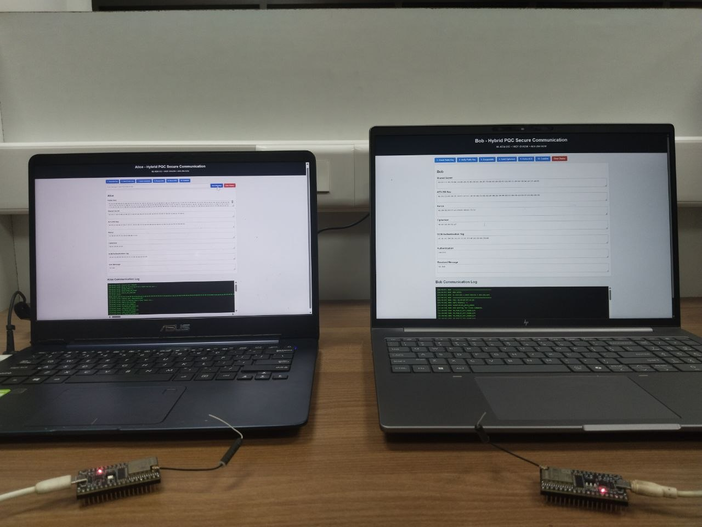

# Hybrid Post-Quantum Cryptography Secure Communication

## Overview

This project demonstrates a hybrid post-quantum cryptography communication system using ESP32 devices and Flask-based graphical user interfaces for Alice and Bob.

The system combines ML-KEM-512 for key encapsulation, HKDF-SHA256 for key derivation, and AES-256-GCM for authenticated encryption.

The project includes ESP32 firmware, Python Flask applications, and graphical interfaces for sending and receiving messages.

## Technologies Used

- ESP32 and Arduino IDE
- Python
- Flask
- Serial communication
- ML-KEM-512
- HKDF-SHA256
- AES-256-GCM

## Project Structure

```text
hybrid-pqc-secure-communication/
├── esp32_firmware/
│   ├── alice_esp32.ino
│   └── bob_esp32.ino
├── alice/
│   ├── alice.py
│   └── templates/
│       └── index.html
├── bob/
│   ├── bob.py
│   └── templates/
│       └── index.html
├── docs/
│   └── images/
│       ├── alice-interface.png
│       ├── bob-interface.png
│       └── hardware-setup.jpg
├── README.md
├── requirements.txt
└── .gitignore
```

*Adjust the filenames in this example if they differ from your actual files.*

## System Workflow

1. Alice and Bob use ESP32 firmware controlled through their respective Flask interfaces.
2. ML-KEM-512 is used for key encapsulation and shared-secret establishment.
3. HKDF-SHA256 derives a cryptographic key from the shared secret.
4. AES-256-GCM encrypts messages and provides authentication.
5. Bob's interface displays the received message and authentication result.

## Demonstration

### Alice — Transmitter Interface

Alice's interface provides controls for the communication workflow and a section for entering and sending messages.


### Bob — Receiver Interface

Bob's interface displays received data, the received message, and the authentication result.


### Hardware Setup

The hardware setup used for the project demonstration.



## Installation and Usage

### 1. Install Python

Install Python 3 on your computer.

### 2. Install Dependencies

Open a terminal in the project directory and run:

```bash
pip install -r requirements.txt
```

### 3. Connect the ESP32 Devices

Connect the Alice and Bob ESP32 devices to the computer. Identify their serial port names and ensure the corresponding Python files use the correct ports.

### 4. Run the Applications

Open separate terminals for Alice and Bob.

For Alice:

```bash
cd alice
python alice.py
```

For Bob:

```bash
cd bob
python bob.py
```

Open the local Flask URLs printed in the terminals. If both applications use the same port, configure separate ports before starting them together.

## Security Note

This project is intended for educational and experimental purposes. Review and test the implementation before using it in security-critical applications. Do not publish private keys, passwords, or actual session secrets.
